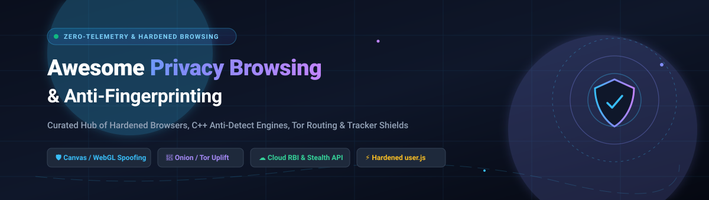

  

# 🛡️ Awesome Privacy Browsing & Anti-Fingerprinting Ecosystem

     

**A definitive, SEO-curated list of hardened privacy browsers, C++ anti-detect stealth automation engines, Remote Browser Isolation (RBI) platforms, Tor/onion routing, and anti-fingerprinting extensions.**

*Protect your digital identity against Canvas, WebGL, AudioContext, Font enumeration, WebRTC IP leaks, and client-side behavioral profiling.*

---

## 📑 Table of Contents

- [🌐 Sector Overview & Market Dynamics](#-sector-overview--market-dynamics)
- [☁️ SaaS & Hosted Platforms](#️-saas--hosted-platforms)
- [💻 Open-Source GitHub Projects](#-open-source-github-projects)
  - [Top Standalone Browsers & Engines](#top-standalone-browsers--engines)
  - [Hardened Configuration Frameworks](#hardened-configuration-frameworks)
  - [Tracker Blocking & Fingerprint Spoofing Extensions](#tracker-blocking--fingerprint-spoofing-extensions)
  - [Fingerprint Auditing, DNS & Privacy Infra](#fingerprint-auditing-dns--privacy-infra)
- [📈 Star History](#-star-history)
- [💖 Support & Sponsorship](#-support--sponsorship)
- [🤝 How to Contribute](#-how-to-contribute)
- [⚠️ Disclaimer](#️-disclaimer)

---

## 🌐 Sector Overview & Market Dynamics

The global privacy-focused browser and anti-tracking sector represents a market valued at approximately **$3.8B to $4.6B**, projected to surge past **$14.7B by the early 2030s at an ~18.4% CAGR**, propelled by heightened consumer surveillance awareness, aggressive tracker proliferation, and enterprise data hygiene regulations. 

The market displays a **hybrid competitive landscape**: it is highly concentrated at the consumer baseline where major engine vendors (Apple Safari, Mozilla Firefox, Brave) shape baseline tracking prevention standards, yet **moderately-to-highly fragmented across specialized privacy niches** where anti-detect suites, remote browser isolation (RBI) vendors, and open-source hardening communities fiercely compete on kernel-level canvas spoofing, residential proxy orchestration, and zero-telemetry architectures.

---

## ☁️ SaaS & Hosted Platforms

The table below catalogs proprietary, commercial, and cloud-integrated privacy browsing ecosystems, remote browser isolation (RBI) environments, and multi-profile anti-detect platforms, sorted in descending order by estimated company scale (annual revenue / valuation):

| SaaS / Product Name | Description & Core Anti-Fingerprint Capabilities | Starting Paid Pricing | Free Tier / Trial Limits | Company Scale (Revenue / Valuation) |
| :--- | :--- | :--- | :--- | :--- |
| **[Mozilla Firefox](https://mozilla.org)** | Mainstream privacy browser featuring Total Cookie Protection, Enhanced Tracking Protection (ETP), and optional Firefox Relay & VPN add-ons. | **$0.99 / mo** (Firefox Relay Premium, billed $11.88/yr) or **$4.99 / mo** (Mozilla VPN, billed $59.98/yr) | **Free forever browser**; Firefox Relay free tier includes up to **50 email masks** and standard tracker removal (10MB max forward). | **~$826M+ Annual Revenue** (Mozilla Corp/Foundation) |
| **[Brave Browser](https://brave.com)** | Chromium browser with built-in Shields for randomized canvas/WebGL/audio fingerprinting mitigation, native Brave Search, and Brave VPN. | **$9.99 / mo** (Brave VPN) or **$5.00 / 1k queries** (Brave Search API) | **Free forever browser**; Brave Search API includes **$5/mo free recurring credit** (~1,000 queries/mo); Brave VPN offers a **7-day free trial**. | **~$980M Valuation** (~$52M–$100M ARR run-rate) |
| **[DuckDuckGo Privacy Browser](https://duckduckgo.com)** | Privacy-first browser featuring Tracker Radar blocking, Fire Button instant data wiping, Duck Player, and bundled Privacy Pro protection. | **$9.99 / mo** ($99.99/yr for Privacy Pro Plus) | **Free forever browser** and search; Duck.ai includes **free daily AI prompt allowance** (dynamic daily computational budget). | **~$236M–$354M Valuation** (~$38M–$74M annual revenue) |
| **[Mullvad Browser](https://mullvad.net)** | Tor Project-developed browser providing uniform crowd-blending anti-fingerprinting over direct connections or the Mullvad VPN mesh. | **€5.00 / mo** (~$5.40/mo flat-rate Mullvad VPN) | **Free forever standalone browser**; Mullvad VPN has **no free tier**, backed by a strict **14-day money-back guarantee**. | **~$30M+ Annual Turnover** (Amagicom AB, profitable & bootstrapped) |
| **[Multilogin](https://multilogin.com)** | Commercial anti-detect browser cloud management platform delivering isolated hardware fingerprints, mobile cloud phones, and proxy automation. | **$11.00 / mo** (Pro 10 plan, or $7.08/mo billed annually) | **Forever Free plan** capped at **5 cloud profiles** (browser/Android), 200MB residential proxy bandwidth, and 30 cloud phone mins. | **~€8M (~$8.7M) Annual Revenue** (Profitable European SaaS) |
| **[Vivaldi](https://vivaldi.com)** | Highly customizable browser with native tracker & ad blocking, end-to-end encrypted sync, and zero user profiling. | **Free** (Monetized via privacy-respecting search and bookmark partner referral fees) | **Free forever with 100% full browser features** (No paid subscription paywalls). | **~$6M–$8M Estimated ARR** (Self-funded Norwegian tech firm) |
| **[Kasm Workspaces](https://kasmweb.com)** | Containerized Remote Browser Isolation (RBI) platform streaming ephemeral disposable browser sessions via WebRTC to stop local fingerprinting. | **$10.00 / user / mo** (Starter / Basic Commercial Tier) | **Community Edition (CE) free forever** for non-commercial use, strictly limited to **5 concurrent sessions**. | **~$2.8M Estimated ARR** (Bootstrapped enterprise cybersecurity) |
| **[GoLogin](https://gologin.com)** | Cloud-synced anti-detect browser supporting Orbita engine spoofing, team profile sharing, and multi-account automation. | **$9.00 / mo** (Professional 10 plan, or $4.50/mo billed annually) | **7-day full-featured free trial**; downgrades to **Forever Free plan** capped at **3 active profiles** and **25 new profile creations/mo**. | **~$2.7M Estimated ARR** (Bootstrapped SaaS) |
| **[Epic Privacy Browser](https://epicbrowser.com)** | Chromium fork featuring an integrated encrypted proxy routing through international nodes, WebRTC leak blocks, and script shields. | **Free** (Monetized through opt-in private search partner agreements) | **Free forever with unlimited proxy access** across all supported platforms (Zero paid tiers). | **~$1M–$2M Estimated ARR** (Hidden Reflex, venture-backed by Graham Holdings) |
| **[Browserling](https://browserling.com)** | Cloud-based interactive cross-browser isolation and cyber testing platform running sandboxed desktop browsers remotely on real virtual machines. | **$9.00 / mo** (Web Testing Starter Plan, billed annually) | **Free limited interactive session** restricted to **3-minute session bursts** on select OS versions. | **~$560k–$1M Estimated ARR** (Lean bootstrapped SaaS) |

---

## 💻 Open-Source GitHub Projects

A comprehensive collection of open-source privacy browsers, C++ anti-detect automation engines, hardening templates, and tracker-blocking extensions. **Ranked in descending order by GitHub stargazers**:

| Repository / Project | GitHub_Stars | Primary Focus & Fingerprinting Defense |
| :--- | :--- | :--- |
| **[gorhill/uBlock](https://github.com/gorhill/uBlock)** |  | Premier open-source wide-spectrum content blocker neutralizing trackers, fingerprinting scripts, and third-party beacons. |
| **[pi-hole/pi-hole](https://github.com/pi-hole/pi-hole)** |  | Network-wide DNS sinkhole shielding all local client browsers from telemetry trackers and data broker domains. |
| **[zen-browser/desktop](https://github.com/zen-browser/desktop)** |  | Modern, beautifully designed Firefox-based privacy browser featuring isolated workspaces, tab containers, and tracking protections. |
| **[SearXNG/searxng](https://github.com/SearXNG/searxng)** |  | Self-hosted, privacy-respecting metasearch engine ensuring search queries cannot be fingerprinted or correlated with client IPs. |
| **[AdguardTeam/AdGuardHome](https://github.com/AdguardTeam/AdGuardHome)** |  | Network-wide privacy DNS server with encrypted DNS-over-HTTPS/TLS/QUIC support to prevent ISP and DNS fingerprinting. |
| **[FingerprintJS/fingerprintjs](https://github.com/FingerprintJS/fingerprintjs)** |  | Open-source client-side browser fingerprinting library; essential benchmark for auditing and testing browser defense resilience. |
| **[ungoogled-software/ungoogled-chromium](https://github.com/ungoogled-software/ungoogled-chromium)** |  | Chromium fork stripped of Google binary blobs, telemetry background requests, and Google URL tracker integrations. |
| **[brave/brave-browser](https://github.com/brave/brave-browser)** |  | Next-generation Chromium browser with C++ Shields for canvas, WebGL, and AudioContext randomization ("farbling"). |
| **[daijro/camoufox](https://github.com/daijro/camoufox)** |  | Open-source anti-detect Firefox browser injecting fingerprint spoofing directly into the C++ engine to evade JS override detection. |
| **[arkenfox/user.js](https://github.com/arkenfox/user.js)** |  | The gold standard Firefox hardening framework activating `privacy.resistFingerprinting` (RFP), letterboxing, and strict isolation. |
| **[jo-inc/camofox-browser](https://github.com/jo-inc/camofox-browser)** |  | Headless anti-detection Firefox browser server designed for autonomous AI agents, web automation, and C++-level spoofing. |
| **[yokoffing/Betterfox](https://github.com/yokoffing/Betterfox)** |  | Pragmatic Firefox `user.js` configuration balancing stringent anti-fingerprinting/telemetry removal with minimal site breakage. |
| **[uazo/cromite](https://github.com/uazo/cromite)** |  | Active successor to Bromite with built-in adblocking, strict site isolation, and canvas/WebGL fingerprint mitigation for Android & Desktop. |
| **[Floorp-Projects/Floorp](https://github.com/Floorp-Projects/Floorp)** |  | Privacy-oriented Japanese Firefox fork featuring multi-row tab setups, strong anti-tracking, and customizable fingerprint mitigations. |
| **[WaterfoxCo/Waterfox](https://github.com/WaterfoxCo/Waterfox)** |  | Telemetry-free Firefox fork providing legacy extension support, isolated tab containers, and encrypted DNS-over-HTTPS. |
| **[bromite/bromite](https://github.com/bromite/bromite)** |  | Renowned armored Chromium browser for Android with automated canvas fingerprint randomization (historical reference codebase). |
| **[EFForg/privacybadger](https://github.com/EFForg/privacybadger)** |  | Electronic Frontier Foundation extension automatically analyzing and blocking third-party domains performing invisible canvas fingerprinting. |
| **[mozilla/multi-account-containers](https://github.com/mozilla/multi-account-containers)** |  | Isolates client-side storage, cookies, and local data into color-coded silo containers to halt cross-site profiling. |
| **[abrahamjuliot/creepjs](https://github.com/abrahamjuliot/creepjs)** |  | Advanced browser fingerprinting auditor revealing audio, canvas, WebGL, speech synthesis, and prototype-tampering leaks. |
| **[GrapheneOS/Vanadium](https://github.com/GrapheneOS/Vanadium)** |  | Hardened Chromium Webview and browser implementation for GrapheneOS featuring exploit mitigations and restricted sensor access. |
| **[ghostery/ghostery-extension](https://github.com/ghostery/ghostery-extension)** |  | Open-source extension combining tracker neutralization, cookie consent auto-dismissal, and search engine privacy metrics. |
| **[kkapsner/CanvasBlocker](https://github.com/kkapsner/CanvasBlocker)** |  | Intercepts and spoofs DOM APIs abused by fingerprinters (HTMLCanvasElement, AudioContext, WebGL, DOMRect). |
| **[hackademix/noscript](https://github.com/hackademix/noscript)** |  | Whitelist-based security suite restricting JavaScript, Flash, WebGL, and active content execution to eliminate script fingerprinters. |
| **[sereneblue/chameleon](https://github.com/sereneblue/chameleon)** |  | Firefox extension enabling custom User-Agent spoofing, screen resolution masking, timezone alteration, and fingerprint noise injection. |
| **[EFForg/cover-your-tracks](https://github.com/EFForg/cover-your-tracks)** |  | The EFF's open-source browser uniqueness diagnostics suite for benchmarking how uniquely identifiable your browser configuration is. |

---

### Top Standalone Browsers & Engines
* 🧅 **[Tor Browser](https://www.torproject.org/)**: The definitive anonymity standard routing all traffic across the decentralized Tor onion network with unified letterboxing and identical crowd-blended fingerprints.
* 🐺 **[LibreWolf](https://librewolf.net/)**: Independent community Firefox fork pre-configured with zero telemetry, native uBlock Origin, and default Tor Uplift (`privacy.resistFingerprinting`).
* 🦊 **[IronFox (formerly Mull / Fennec)](https://gitlab.com)**: Privacy-hardened Android Firefox fork incorporating Arkenfox user.js configurations and Tor fingerprinting resistance.
* 🕵️ **[Camoufox](https://github.com/daijro/camoufox)**: C++-modified anti-detect Firefox binary engineered specifically for stealth web scraping and AI agent workflows without synthetic JS detection.

---

## 📈 Star History

  

---

## 💖 Support & Sponsorship

Thank you for exploring and bookmarking **Awesome-Privacy-Browsing-Anti-Fingerprinting**! 🙏

If you find this repository valuable for your research, personal privacy, or engineering workflows, please consider supporting the project:
* ⭐ **Star the repository** to boost visibility and help others discover privacy tools.
* 🍴 **Fork and contribute** new anti-fingerprinting projects or research findings.
* 📢 **Share with privacy advocates, security researchers, and developers**.
* ☕ **Buy a coffee or sponsor ongoing maintenance**: [Sponsor Dashboard on GitHub](https://github.com/sponsors/ishandutta2007)

Every contribution helps keep this ecosystem accurate, independent, and up to date!

---

## 🤝 How to Contribute

1. Fork the repository.
2. Add or update projects in `README.md` following the established table formats.
3. Ensure all links are active, accurate, and include objective capability descriptions.
4. Open a Pull Request with a brief description of your additions.

---

## ⚠️ Disclaimer

- This is a community-curated collection for educational, research, and defensive security purposes.
- **The Fingerprinting Paradox**: Over-aggressive browser modification through simplistic extensions can ironically make your browser *more* uniquely identifiable. Kernel-level and C++ implementations (such as Tor Browser, Mullvad Browser, and LibreWolf RFP) offer superior crowd-blended anonymity.
- Always review and adhere to relevant website terms of service and legal regulations when utilizing automated browsing software.

---

  <b>Built for privacy advocates, security researchers, journalists, and open-source defenders worldwide. 🛡️</b>

